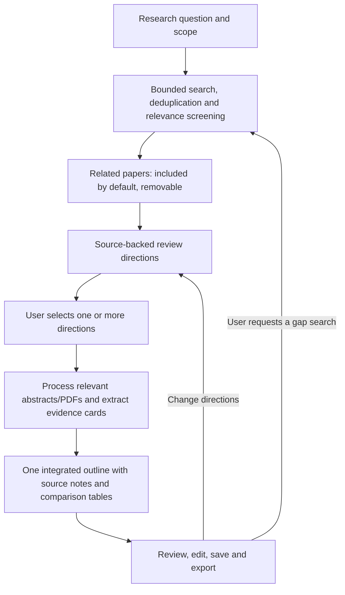

# LitWeave · Evidence-Grounded Literature Review Agent

[English](README.md) | [简体中文](README.zh-CN.md)

Turn a research question into a **source-backed literature review outline**. Search and
screen papers, choose review directions, then compare author-reported methods, data,
metrics, findings and limitations in one integrated outline.

The Python/LangGraph workflow runs in a Streamlit web interface or an interactive CLI.
Both support English and Chinese.

## What you can do

- **Build a relevant reading set.** Search arXiv, Crossref and Semantic Scholar; normalize
  and deduplicate records; see titles, relevance explanations and original-paper/DOI links.
  Relevant papers are included by default and can be removed.
- **Choose the review's direction.** Get a target of 5–10 combinable subthemes based on
  retained source excerpts, see their supporting papers and select multiple directions.
- **Compare the literature.** Extract research questions, populations/conditions, methods,
  data/experimental settings, metrics, findings and stated limitations from available
  abstracts or readable PDFs. Comparison tables show what the authors actually reported.
- **Keep sources attached.** Outline sections link facts to the retained papers and
  abstract/PDF-page locations. Missing or unprocessed information remains explicit.
- **Control the next step.** Edit the outline, change directions, request gap searches,
  retry incomplete extraction, or export and resume a saved project.

The focus is the research process: a reusable literature set, explicit user choices,
source-linked comparison material and a resumable outline. It does not generate an
original study or replace your interpretation of the literature.

## Workflow



The search targets at least **5 relevant papers**, with bounded supplemental searches.
If fewer are found, you can continue with the available set or request further search
within the remaining budget. It never fills the list with rejected papers.

You do not need to change the default paper selection. Direction options are checked
individually, so an invalid citation does not discard the other valid options. Fewer
than five valid directions remain usable. Later evidence-gap searches require a click.

## Quick start

Use Python **3.11+**. Local offline checks used Python 3.13.9; direct dependencies are
listed in [requirements.txt](requirements.txt), rather than a fully resolved lockfile.

### Windows / PowerShell

```powershell
git clone https://github.com/Jiabujiabu/litweave.git
cd litweave
python -m venv .venv
.\.venv\Scripts\Activate.ps1
python -m pip install -r requirements.txt
Copy-Item .env.example .env
$env:PYTHONIOENCODING="utf-8"
python -m streamlit run streamlit_app.py
```

### macOS / Linux

```bash
git clone https://github.com/Jiabujiabu/litweave.git
cd litweave
python3 -m venv .venv
source .venv/bin/activate
python -m pip install -r requirements.txt
cp .env.example .env
python -m streamlit run streamlit_app.py
```

Open the local URL printed by Streamlit. Select **English / 中文** in the sidebar
before starting a study. For the CLI, run `python main.py` instead and follow the
numbered language, provider and model prompts.

## Configure a model

1. Choose **OpenAI**, **Anthropic** or **DeepSeek**.
2. Choose a model preset or enter a **custom model ID**.
3. Enter your API key for that provider.
4. Read the fee notice and click **Test connection**. This sends one bounded real request.
5. After a successful test, enter your research question and start.

Changing the provider, model or key requires a new connection test. **Refresh model
list** only retrieves model metadata; it is separate from generation verification and
does not overwrite your choice. Failure to load a list does not block a custom ID.

Each web session and interactive CLI session uses the key supplied by its user. API
usage is billed by the provider. Keys are excluded from project exports, graph
checkpoints and diagnostic logs; the hosting backend receives the key to call that
provider. Clear credentials when finished. Keep `.env` local and out of version control.

[Model presets](config/model_presets.json) record API IDs, capabilities, official sources
and check dates. Adapters handle provider-specific token limits, thinking controls and
structured-output parameters. Google is not offered because no adapter is implemented.
See [model configuration details](docs/model_configuration_and_validation.md).

## PDFs, projects and exports

- Original-paper, DOI and available open-access links appear with each result.
- Upload a local PDF under its paper. If its abstract is missing, readable local PDF text
  can support direction generation; this stage does not automatically download remote PDFs.
- After direction selection, the agent processes the selected directions' supporting
  documents. Abstract-only evidence does not establish details absent from the abstract.
- **Retry incomplete extraction** reuses successful fields and the remaining run budget;
  it does not restart the search. CLI outline review exposes the same action as option 7.
- Save `project.json` at a review stage. Import it from the start screen, or use
  `python main.py --project path/to/project.json`. Configure your key separately.
- Export `outline.md`, `evidence_cards.csv`, `paper_decisions.csv` and `project.json`.
  Projects retain processed source text, decisions, history and cumulative budgets.

Unsaved state is process-local. Save a project before stopping the app. Project files
contain research material and should be shared deliberately.

## Limits and troubleshooting

All settings accept `RESEARCH_<UPPERCASE_FIELD>` environment variables; see
[.env.example](.env.example) and [settings.py](settings.py).

| Default per-run limit | Value |
| --- | --- |
| Selected papers / fulltext attempts | 10 / 10 |
| Supplemental search rounds | 2 total; at most 1 initial automatic round |
| Model calls / total HTTP and model requests | 30 / 80 |
| Conservative token reservation / output ceiling per call | 100,000 / 4,096 |
| Evidence context budget | 12,000 |
| PDF size / pages | 20 MB / 100 |

Task-specific output ceilings may be lower. Failed attempts consume budget; explicit
retries do not reset it. Token/request limits are engineering limits, not a price quote.

| Symptom | Next step |
| --- | --- |
| Connection test fails | Read the provider/status/reason; check credentials, model access, balance, limits or network as indicated. It never reports mock output as a real success. |
| No review directions | Read the specific material, format, citation, provider or budget reason. Retry when available, or return to the literature list to add material. |
| Incomplete comparison cells | Check whether source text was available and processed; add a PDF or retry incomplete extraction when budget permits. |
| Embedding weights unavailable | The app reports a BM25 fallback. `ALLOW_EMBEDDING_DOWNLOAD=1` separately permits an initial model download. |
| Source rate limit or timeout | Partial results remain available; source errors are tracked separately from empty search results. |

Citation integrity and model-assisted support checks are separate. Unavailable checks
remain `not_checked`. There is no OCR or reliable table/figure extraction, automatic
scientific-completeness assessment, or authenticated multi-user hosting layer.

## Offline tests and verification

```powershell
# PowerShell; in bash use: export MOCK_MODE=1
$env:MOCK_MODE="1"
python -m unittest discover -s tests -q
python demo.py --scenario fulltext
python demo.py --scenario abstract
python demo.py --scenario insufficient
```

The latest local suite passed **150 offline tests**, including default-selection flow,
direction validation, per-paper extraction coverage, provider switching/error handling,
project restore and Streamlit interaction checks. Tests and demos use synthetic fixtures
and SDK doubles, not paid model calls or real-paper quality benchmarks. Fixture provenance:
[tests/fixtures/README.md](tests/fixtures/README.md).

The maintainer has also confirmed the basic workflow through manual real use. That does
not establish a general accuracy or speed benchmark. A recorded DeepSeek connection
test passed; OpenAI and Anthropic adapters have offline tests but no maintainer-recorded
live verification. A fresh dependency installation has not been network-tested.

## Documentation and development

- [Current workflow / 当前流程（中文）](docs/direction_selection_workflow.md)
- [Concrete outline material / 具体大纲材料（中文）](docs/concrete_outline_material.md)
- [Per-paper extraction fix / 逐篇提取修复（中文）](docs/per_paper_extraction_fix.md)
- [Direction-generation fix / 方向生成修复（中文）](docs/direction_generation_fix.md)
- [Technical reference](docs/technical_reference.md)
- [Data model](docs/data_model.md), [evaluation guide](docs/annotation_guide.md)
  and [implementation log](docs/implementation_log.md)

`graph.py` and `workflow.py` coordinate the shared workflow; `directions.py` manages
source-backed choices; `documents.py`, `card_inputs.py` and `evidence.py` prepare sources;
`review_workflow.py` and `writing_support.py` build review material; `projects.py` handles
portable snapshots. `provider_adapters.py` implements model protocols.

The initial evaluation scope is CS/AI; cross-field quality has not been established.
Historical evaluation logs describe their original experiments, not current factual
accuracy. Paid evaluation runners require explicit opt-in; ordinary offline tests do not.

Thanks to [arXiv](https://info.arxiv.org/help/api/index.html),
[Crossref](https://www.crossref.org/documentation/retrieve-metadata/rest-api/access-and-authentication/)
and [Semantic Scholar](https://www.semanticscholar.org/product/api) for their literature APIs.
Design references include [PaperQA](https://github.com/Future-House/paper-qa),
[PaSa](https://github.com/bytedance/pasa) and
[Open Deep Research](https://github.com/langchain-ai/open_deep_research).
