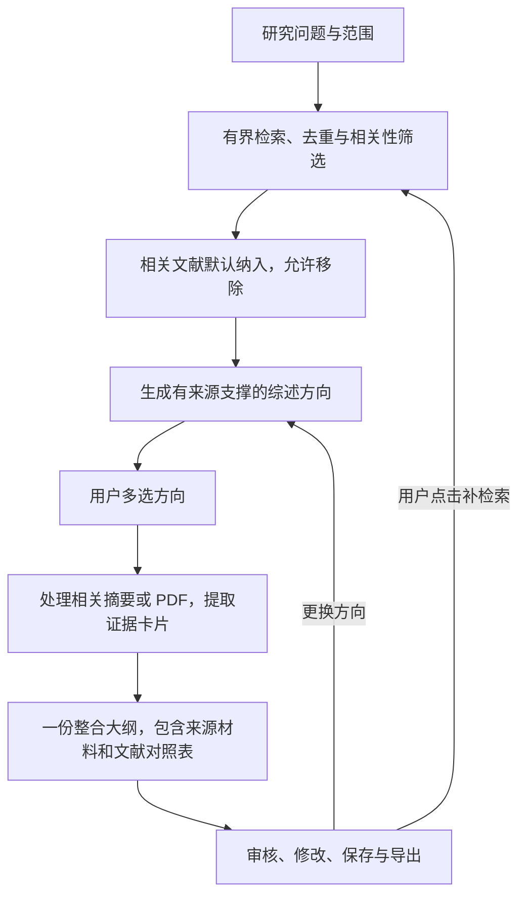

# LitWeave · 文献证据综述助手

[English](README.md) | [简体中文](README.zh-CN.md)

从一个研究问题出发，生成**有文献来源支撑的学术综述大纲**：检索并筛选文献，
选择综述方向，提取作者报告的方法、数据、指标、发现与局限，再组织成一份整合大纲。

项目使用 Python 和 LangGraph，提供 Streamlit 网页界面及交互式命令行，两者均支持中英文。

## 可以用它做什么

- **建立相关文献集。** 从 arXiv、Crossref 和 Semantic Scholar 检索，规范化并去重，
  展示标题、相关理由和原文／DOI 链接。相关文献默认纳入，用户可以移除。
- **选择综述方向。** 根据保留文献中的文本，目标生成 5–10 个可组合的子主题，
  展示每个方向的支撑文献，供用户多选。
- **对比研究内容。** 从可用摘要或可读 PDF 提取研究问题、对象与条件、方法、数据与实验设置、
  评价指标、发现及作者明示的局限。文献对照表提供作者实际报告的内容。
- **保留来源。** 大纲中的事实关联文献及摘要／PDF 页码；未提取或材料没有说明的信息会明确标注。
- **控制下一步。** 修改大纲、更换方向、主动补检索、重试未完成的提取，或保存项目后恢复。

项目的重点是组织研究过程：可复用的文献集、用户选择、可追溯的比较材料，以及可恢复的大纲。
它不会替你完成原创实验或个人学术判断。

## 工作流程



以至少 **5 篇相关文献**为目标，补检索有次数限制。不足 5 篇时，用户可以使用已有文献，
或在剩余额度内继续检索；不会用不相关论文凑数。

**无需手动修改默认文献选择。** 每个方向独立校验，一个错误引用不会影响其他有效选项。
有效方向不足 5 个时仍可继续使用。后续证据缺口需要用户点击后才会补检索。

## 安装与启动

建议使用 Python **3.11+**。本地离线检查使用 Python 3.13.9。
[requirements.txt](requirements.txt) 列出直接依赖，尚不是完整锁定的依赖清单。

### Windows / PowerShell

```powershell
git clone https://github.com/Jiabujiabu/litweave.git
cd litweave
python -m venv .venv
.\.venv\Scripts\Activate.ps1
python -m pip install -r requirements.txt
Copy-Item .env.example .env
$env:PYTHONIOENCODING="utf-8"
python -m streamlit run streamlit_app.py
```

### macOS / Linux

```bash
git clone https://github.com/Jiabujiabu/litweave.git
cd litweave
python3 -m venv .venv
source .venv/bin/activate
python -m pip install -r requirements.txt
cp .env.example .env
python -m streamlit run streamlit_app.py
```

打开 Streamlit 输出的本地地址，在侧边栏选择 **English / 中文**，再开始研究。
如果使用命令行，改为运行 `python main.py`，按编号选择语言、厂商和模型。

## 配置模型

1. 选择 **OpenAI、Anthropic 或 DeepSeek**。
2. 选择预设模型，或输入**自定义模型 ID**。
3. 输入该厂商的 API Key。
4. 阅读费用提示后点击**测试连接**，发送一次限制输出长度的真实请求。
5. 验证通过后，输入研究问题并开始。

切换厂商、模型或 Key 后需要重新测试连接。**刷新模型列表**只读取模型元数据，
不代表真实生成通过，也不会覆盖当前选择；列表获取失败不妨碍测试自定义 ID。

网页会话与交互式 CLI 使用各自用户提供的 Key，API 费用由对应厂商计入该账户。
Key 不写入项目导出、图状态检查点或诊断日志；服务端会接收 Key 并调用所选厂商。
使用结束后可以清除凭据。`.env` 仅在本地保存，不应提交到版本库。

[模型预设配置](config/model_presets.json) 独立保存实际 API ID、参数能力、官方来源及核对日期。
各厂商适配器分别处理输出上限、思考模式和结构化输出参数。尚未实现 Google 适配器，因此不提供该选项。
详见[模型配置与验证](docs/model_configuration_and_validation.md)。

## PDF、项目恢复与导出

- 文献结果提供原文页面、DOI 及可用的开放全文链接。
- 可在对应文献下上传本地 PDF。摘要缺失时，可读的本地 PDF 能用于生成方向；
  方向阶段不会自动下载远程 PDF。
- 选择方向后，处理这些方向的支撑文献。仅有摘要时，不会将摘要未包含的实验细节当作事实。
- **重试未完成提取**会复用已成功的字段和剩余额度，不会重新开始检索。CLI 大纲审核的选项 7 提供相同操作。
- 在审核阶段保存 `project.json`，从开始页导入，或运行
  `python main.py --project path/to/project.json`。恢复时单独输入和验证 Key。
- 支持导出 `outline.md`、`evidence_cards.csv`、`paper_decisions.csv` 和 `project.json`。
  项目保留已处理的来源文本、选择决定、历史和累计预算。

未保存的状态只在当前进程中保留，停止应用前请先保存项目。项目包含研究材料，请按需分享。

## 额度与常见问题

设置可通过 `RESEARCH_<大写字段名>` 环境变量调整，参见
[.env.example](.env.example) 和 [settings.py](settings.py)。

| 每轮研究的默认限制 | 数值 |
| --- | --- |
| 纳入文献数／全文处理尝试数 | 10／10 |
| 补检索轮次 | 总计 2 轮；初始最多自动补充 1 轮 |
| 模型调用／HTTP 与模型请求总数 | 30／80 |
| 保守 token 预留总额／单次输出上限 | 100,000／4,096 |
| 证据上下文额度 | 12,000 |
| 单份 PDF 大小／页数 | 20 MB／100 页 |

具体任务的输出上限可能更低。失败尝试也计入额度，重试不会重置预算。
这些是工程限制，不是货币费用承诺。

| 遇到的情况 | 建议操作 |
| --- | --- |
| 测试连接失败 | 按厂商、状态码和原因检查认证、模型权限、余额、限流或网络。演示输出不会被当作真实验证成功。 |
| 无法生成方向 | 查看材料、格式、引用、服务或额度的具体原因；有额度时重试，或返回文献列表补充材料。 |
| 文献对照内容未完成 | 查看原文是否可读、是否已处理；补充 PDF，或在剩余额度内重试未完成提取。 |
| 本地没有嵌入模型权重 | 显示 BM25 回退；可单独设置 `ALLOW_EMBEDDING_DOWNLOAD=1` 允许初次下载权重。 |
| 文献接口限流或超时 | 保留已得到的结果，来源请求失败与检索结果为空分别记录。 |

引用完整性与模型辅助支持判断分别记录；未执行的检查保持 `not_checked`。
目前没有 OCR、可靠的表格／图片内容提取、自动科学完整性评估或带身份认证的多用户托管层。

## 离线测试与验证范围

```powershell
# PowerShell；bash 中使用 export MOCK_MODE=1
$env:MOCK_MODE="1"
python -m unittest discover -s tests -q
python demo.py --scenario fulltext
python demo.py --scenario abstract
python demo.py --scenario insufficient
```

最近一次本地测试通过 **150 项离线测试**，覆盖默认选择流程、方向校验、逐篇提取覆盖、
厂商切换与错误处理、项目恢复和 Streamlit 交互。测试及演示使用合成材料和 SDK 替身，
不调用付费模型，不代表真实文献质量基准。材料来源见[测试夹具说明](tests/fixtures/README.md)。

维护者也已通过真实手动使用确认基础流程可用，但尚没有通用的准确率或速度基准。
已有一次 DeepSeek 连接测试记录；OpenAI、Anthropic 适配器通过离线测试，
尚无维护者记录的真实 API 验证。全新环境的依赖安装尚未通过联网测试。

## 文档与开发

- [当前使用流程](docs/direction_selection_workflow.md)
- [具体大纲材料与文献对照](docs/concrete_outline_material.md)
- [逐篇提取修复](docs/per_paper_extraction_fix.md)
- [方向生成修复](docs/direction_generation_fix.md)
- [技术参考（英文）](docs/technical_reference.md)
- [数据模型（英文）](docs/data_model.md)、[评估指南](docs/annotation_guide.md)
  及[实现记录](docs/implementation_log.md)

`graph.py` 与 `workflow.py` 协调共享流程；`directions.py` 管理方向生成和选择；
`documents.py`、`card_inputs.py`、`evidence.py` 处理来源材料；
`review_workflow.py` 与 `writing_support.py` 生成综述材料；`projects.py` 保存可恢复项目；
`provider_adapters.py` 处理模型厂商协议。

初始评估范围为 CS/AI，跨学科质量尚未建立。历史评估日志仅描述当时实验，不代表当前事实准确率。
付费评估脚本需要显式开启，普通离线测试不会调用付费 API。

感谢 [arXiv](https://info.arxiv.org/help/api/index.html)、
[Crossref](https://www.crossref.org/documentation/retrieve-metadata/rest-api/access-and-authentication/)
及 [Semantic Scholar](https://www.semanticscholar.org/product/api) 提供文献 API。
设计参考包括 [PaperQA](https://github.com/Future-House/paper-qa)、
[PaSa](https://github.com/bytedance/pasa) 和
[Open Deep Research](https://github.com/langchain-ai/open_deep_research)。
