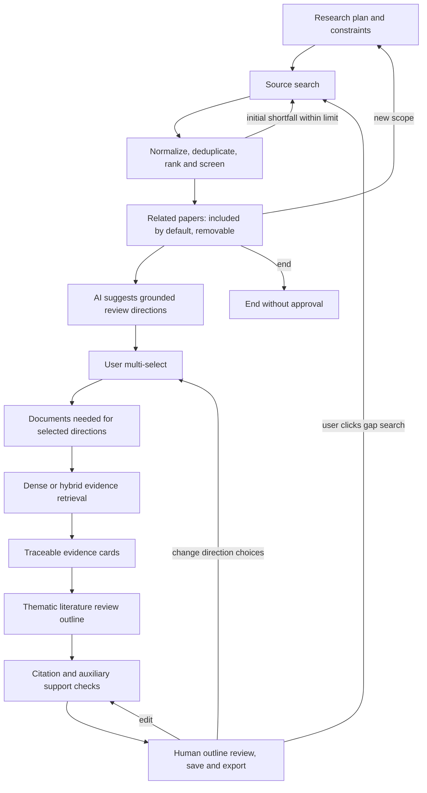

> Detailed implementation reference. Start with the [English README](../README.md) or [中文说明](../README.zh-CN.md).

# Academic Research Agent / 学术调研助手

A personal research assistant built with Python and LangGraph. CLI and Streamlit
share the same graph, concise related-paper results, direction multi-select and outline checks.
The first evaluation scope is CS/AI. The humanities/interdisciplinary search entry remains;
quality across fields is **not established**.

研究问题 → 有界检索并筛选相关文献（目标至少 5 篇） → **默认保留，可移除** →
AI 从摘要归纳 5–10 个方向 → **用户多选** → 针对所选方向处理材料 → 一份整合综述大纲。
结果不足 5 篇时明确提示，用户可继续检索或使用已有文献。后续证据缺口仍需点击才补检索。

## Install and run

Python 3.11+ is recommended (local checks used Python 3.13.9). Create an environment,
then install dependencies. The tested local versions are in `docs/baseline.json`; pypdf
6.10.0 was additionally tested. The requirements specify direct dependencies, not a
fully resolved lockfile; installing into a fresh environment has not been network-tested.

```powershell
python -m venv .venv
.\.venv\Scripts\Activate.ps1
python -m pip install -r requirements.txt
Copy-Item .env.example .env
$env:PYTHONIOENCODING="utf-8"
# Default to offline demo; real web use requires explicitly leaving demo and entering your own key:
$env:MOCK_MODE="1"
python main.py
# or:
python -m streamlit run streamlit_app.py
```

## Offline demos and checks

```powershell
$env:MOCK_MODE="1"
python -m unittest discover -s tests -v
python demo.py --scenario fulltext
python demo.py --scenario abstract
python demo.py --scenario insufficient
python eval/replay.py
```

These use original CC0 synthetic text/PDF fixtures and deterministic test embedders;
they make no network/model calls or embedding-weight downloads. Fulltext/abstract demos
use `min_papers=1`; insufficient uses 5 and a zero evidence-context budget, all recorded.
The first demo reads a local PDF and exports page-linked evidence, the second falls
back to full abstracts, and the third produces no scientific claims because evidence
is insufficient. MOCK support checks stay `not_checked`; they cannot establish a pass.
Demo output is in `.research_runs/demos/`. Replay creates a unique run directory with
manifest, JSONL and CSV. Its scripted judge is explicitly `fixture_stub`, not model or
human evidence of quality. Source/license details: `tests/fixtures/README.md`.

## Model configuration, real API validation and limits

Web: choose provider → model preset or custom API ID → enter your own key → explicitly
click **Test connection** after reading the fee notice. The model label and API ID are
separate. One bounded real generation (default 64 output tokens) must pass before real
research starts. A provider/model/key change invalidates the previous verification.
**Refresh model list** is a separate, optional metadata operation: it never verifies
generation, overwrites a selection or prevents testing a configured model if it fails.

Interactive CLI uses the same numbered provider/model/key/test flow (`MOCK_MODE=0`).
Missing an environment key does not force demo. An explicit `MOCK_MODE=1` enables the
existing offline demo; demo results can never pass real API validation. Local batch
experiments have an explicit environment helper; visitors' requests do not use it.

Presets and verified parameter capabilities live in `config/model_presets.json`, with
official sources and check dates (2026-10-31). Only implemented/tested adapters are shown:
OpenAI, Anthropic, DeepSeek. Google is not shown. Unknown custom IDs use conservative
provider-specific parameters. Clients are built from the CURRENT credential context,
not a module-import-time model/client. Failures never silently change models/accounts.

Provider adapters distinguish output-limit parameter names, temperature support, thinking
controls and structured-output formats. Research task schemas are local and provider
formatting is applied only where supported. Failures retain provider/base URL/model ID,
actual HTTP status and redacted reason in `.research_runs/api_diagnostics/events.jsonl`;
raw keys, prompts, request headers and full response bodies are not logged.

**Previously verified API connection:** DeepSeek / `deepseek-flash`, HTTP 200, reply `OK`,
3.379s, 9 input + 1 output tokens, using one explicitly authorized test capped at 32
output tokens. OpenAI/Anthropic lack keys and are **not live-verified**. Other DeepSeek
models were not tested live. Full provenance and limitations:
`docs/model_configuration_verification.json` and `docs/model_configuration_and_validation.md`.
The old failed request has no retained raw response; its historical cause is not inferred.
The literature-review workflow implementation used offline fixtures only, with no new paid
request or real-paper quality/latency benchmark. The connection test does not validate
the complete new extraction/outline workflow.

Keys remain in current-session backend memory/transient contexts, excluded from graph
state/checkpoints, files and exports. Clear them when finished. The host backend receives
the user key and forwards it to the selected provider; this is not client-only execution
or a complete public-deployment security audit. Model API fees go to the supplied account;
hosting/storage are separate operating costs. Existing `.env` was not modified.

Embeddings use `EMBEDDING_MODEL`, local weights only by default. Set
`ALLOW_EMBEDDING_DOWNLOAD=1` separately to permit the initial weight download. Optionally
set `EMBEDDING_REVISION` to a pinned model revision for reproducibility. Missing weights
are visible as `bm25_fallback` for both paper ranking and evidence retrieval;
they never count as semantic retrieval or successful evidence checks.

All `Settings` fields accept `RESEARCH_<UPPERCASE_FIELD>` environment variables; the
example lists common options. Defaults: 10 selected papers, 10 fulltexts, 2 supplemental
rounds shared by paper/evidence gaps, 3 review redos, 1 local revision per claim, 80 total
HTTP/model requests, 30 model calls, 20s request timeout, 20MB/100 pages per PDF.
A 100,000-token conservative reservation ceiling includes inputs and maximum outputs;
reported provider usage is recorded separately. Output max is 4096 tokens per call.
This is an engineering token/request budget, not a currency guarantee. Cost stays
`unknown` without a configured price source. Failed attempts also consume request/call
budgets. Provider SDK retries are disabled so hidden retries do not escape accounting.

Search events distinguish success, empty, rate_limited, timeout and failed. Requests are
sequential with source pacing and bounded retries; long Retry-After values defer the
request instead of retrying early. arXiv, Crossref and Semantic Scholar metadata are
adapted to a common schema. No paid-wall bypass or model-constructed PDF URLs is used.

## Review, PDFs, projects and export

See `docs/direction_selection_workflow.md` for the current Chinese use case.
The normal results list shows only directly relevant or substantively related papers,
with title, year, a short connection and source links. Results default to included and
can be removed; rejected/unjudged candidates remain in records, outside the main list.
Abstracts/PDF upload, search details and diagnostics are collapsed. Raw title retention,
entity decoding and Unicode normalization remain. A missing/failed judgment is not a
negative, and the five-paper target is not permission to pad unrelated results.

When initial results are insufficient, the default permits one bounded additional source
round before showing results. `RESEARCH_INITIAL_SUPPLEMENT_ROUNDS` controls this, within
the existing total `max_search_rounds=2`; later searches require user action. Below five,
the user can continue with available literature or use the remaining search budget.

AI proposes 5–10 distinct, combinable review directions from retained abstract excerpts
(or an uploaded local PDF when the abstract is missing), in one call with a source
whitelist and short paper/source aliases. Default-included papers require no manual
change. Each option is validated independently: an invalid citation discards that option,
not the other valid choices. Each option maps to supporting papers. Users must
select one or more; there is no automatic selection. If fewer distinct angles are
returned and validated, show those available choices. Failures distinguish unreadable
material, invalid format/citations, provider failures and exhausted budgets. Failed retries
preserve prior validated options for unchanged source material. Retries share existing
budgets; no automatic remote PDF download is added at this stage. Failures never become
mock success. See `docs/direction_generation_fix.md` for diagnosis and validation scope.

Upload a PDF under its paper, or enter CLI `paper_id=C:\path\paper.pdf` (separate mappings
with `;`). After direction selection, process documents needed by those directions and
extract question, conditions, methods, data/experimental setting, evaluation metrics, findings,
limitations and topic relationship into evidence cards. Missing fields distinguish
`not_found_in_processed_text` from `not_checked`. Original excerpts, locations and IDs
remain separate from model extraction. Abstract-only cards cannot establish unseen details.

PDFs retain page locations and recognizable sections. Failed/empty/scanned/oversized
PDFs fall back to the complete abstract; metadata-only candidates cannot support claims.
Chunking targets roughly 500 conservative text units with 75 overlap, configurable and
not experimentally optimized. Repeated edge lines are removed conservatively. Reference
sections are retained but excluded from scientific evidence retrieval. Parser/chunk config,
content hash, paper version and configured embedding identity participate in cache keys.
Caches, uploaded PDFs, local environments and run outputs are gitignored.

`dense` and `hybrid` are separately runnable. Hybrid uses BM25 + dense RRF, not an addition
of incompatible raw scores. Per-paper quotas, duplicate-text suppression and a deterministic
character-bound context budget limit the evidence set. Optional `RESEARCH_RERANK=1` enables
a local BM25 rerank **baseline**, not a learned cross-encoder or proof of improvement.
Retrieval traces retain candidates, component scores and selected evidence IDs.

The product generates a **literature review outline**, grouped by themes/methods/conditions,
not one summary per paper. Nodes contain writing purpose, question IDs, atomic arguments,
counterevidence, conditions, gaps and user writing tasks. Author findings, synthesis,
hypotheses and user ideas are labeled separately. Factual arguments require whitelisted
evidence IDs from the retained corpus. Selected direction IDs are included in thematic
nodes and one integrated outline covers the choices. Each section now includes concrete
author-reported material: questions/populations, procedures, datasets, metrics, findings
and limitations, with paper links and actual abstract/PDF-page locations. Comparison
tables are filled from those extracted fields and explain which reported dimensions
to juxtapose. Identical tables are reused; missing fields remain explicitly unextracted
or absent from the processed text. Different datasets/metrics do not become a ranking.
The default frontend has no Evidence and check details panel, check JSON or JSON outline
editor. Source links and human-readable facts stay visible; technical records remain in
exports. Generated personal hypotheses and generic writing homework are omitted.
You can edit/reorder, accept a partial outline, return to directions/papers/PDFs, end or
explicitly search selected evidence gaps. Related new results default to retained with
removal controls; existing exclusions survive further search and metadata updates.
User-edited wording survives regeneration; removed sources invalidate citations and mark
preserved wording as needing evidence. Scope changes save history and require re-screening.

Citation integrity is separate from auxiliary model support. Disabled/unavailable checks
stay `not_checked`; failed checks never become successful at a retry limit. Coherence,
semantic redundancy and scientific completeness are explicitly not automatically verified.
Accepting a partial outline records `accepted_partial`, without changing check results.
The original generic report helpers remain available to historical offline evaluations.
`writing_support.py` assembles source-backed section content independently of the optional
outline synthesis request. If generation runs out of its existing call/context budget,
available extracted facts remain visible and synthesis is marked incomplete. One invalid
card field no longer discards the other valid fields. Legacy six-field cards are accepted
with data/metric fields marked not_checked. Repeated factual support checks share a cache
across sections; no budget ceilings are increased and no scientific pass is inferred.
Current Chinese guide: `docs/concrete_outline_material.md`.

Per-paper extraction now uses `card_inputs.py`, independently of topic-wide top-k. A first
bounded excerpt is reserved for every readable paper in the selected directions before
extra excerpts are assigned; abstract/PDF text slices get their own hashes and IDs.
The extraction pool stays within `context_tokens`; retained source references in the local
project are not all sent as one prompt. Native-schema reservation counts only parameters
actually sent (DeepSeek JSON-object requests do not transmit the local schema). Card and
support output caps are 2048/384 or the lower configured ceiling; run budgets do not grow.
Blank/partial cards are not completed-cache hits. Missing material, allocation limits,
model/request budgets and invalid/provider responses have distinct readable reasons.
Both outline review and the completed-result page offer **Retry incomplete extraction**
when materials and budget permit. It reuses completed results and never restarts search,
downloads or budgets. CLI outline review offers the same action as option 7.
Guide: `docs/per_paper_extraction_fix.md`.

At the results, direction-choice or outline stage, download `project.json`. Restore it from the start screen after
entering and validating your own key; no search/generation is triggered by restore alone.
CLI: `python main.py --project C:\path\project.json`. The snapshot retains decisions,
processed source text, corpus/outline versions, history and cumulative budgets, excluding
credentials, clients and private PDF paths. Re-upload a PDF to replace its content.
CLI's numbered save action writes an atomic project snapshot. Final export contains
`outline.md`, `evidence_cards.csv`, `paper_decisions.csv`, `project.json`.
For CLI outline editing, copy a project, edit `state.outline`, then choose the outline
review's JSON-edit action; it validates the references before replacing the current draft.

## Evaluation and historical results

See `docs/annotation_guide.md`. The formal proposal has 10 development and 20 frozen
heldout CS/AI topic clusters (`eval/splits.json` plus hash). Historical ten repeatedly used
topics are development/history only. The new heldout corpus has not been collected or
human-labeled; pending materials are delivered instead of fabricated results.

`eval/replay.py` separates fixed-corpus comparisons: abstract/fulltext, dense/hybrid,
rerank off/on and support-check off/on. It also exports randomized blind development
annotation materials from the historical candidate snapshot, hiding version, scores and
LLM suggestions. Human rows remain blank. Once annotated, score against a separately
saved ranking (not the shuffled CSV order):

```powershell
python eval/score_blind.py --labels blind_candidates.csv --mapping evaluator_mapping.json --ranking ranking.json
```

`ranking.json` is a list of `{topic, ranked_paper_ids}` objects; optional
`known_relevant_ids` defines an incomplete known reference set. Selected-paper relevance,
actual-citation relevance, citation integrity/coverage and claim support are separate
metrics. Unknown/duplicate IDs fail; missing/error/unjudged items do not become negatives.
Zero denominators are null; no-citation substantive reports are not 100% correct.

Historical files remain unchanged. Log4 reports 76/92=82.61%; log5 reports 71/90=78.89%.
These were model-judged **selected-paper relevance on exposed topics**, not report factual
accuracy or validated generalization. The difference alone cannot establish a regression.
Legacy real runners have been adapted to the new model and save new run directories.
They reject MOCK and require explicit `ALLOW_PAID_EVAL=1` plus configured local budgets;
that opt-in was not used here. Other archived analysis scripts remain historical tools.

## Architecture and limits



`papers.py`: adapters/identity. `searches.py`: bounded source requests.
`documents.py`: fulltext/chunks/cache. `evidence.py`: local vector/BM25/RRF index.
`reports.py`: reusable claim checks. `review_workflow.py`: two gates/cards/outline/versions.
`directions.py`: concise result eligibility, grounded proposals and explicit multi-select.
`projects.py`: portable snapshots/exports; `review_ui.py`/`review_cli.py`: review surfaces.
`workflow.py` and `graph.py`: shared retrieval and state machine.
`nodes.py`: retained provider entry and compatibility exports. `evaluation.py` and `eval/`:
independent metrics, manifests and annotation tools. `docs/implementation_log.md` records
commands, results and limitations; `docs/baseline.json` preserves original behavior.

No OCR, table/figure understanding, sophisticated formula parsing, guaranteed section
recognition, authenticated multi-user service, unattended crash recovery or trained new model.
MemorySaver remains process-local; explicit project save/load provides portable recovery
at human review gates. Unsaved work is not automatically recovered. PDF and metadata quality
can fail; semantic retrieval and support-model accuracy have not been independently
validated. Real network/provider integration, human heldout evaluation and repeated
stochastic ablations remain pending. No push or publication is performed automatically.

Design references only: [PaperQA](https://github.com/Future-House/paper-qa),
[PaSa](https://github.com/bytedance/pasa), and
[Open Deep Research](https://github.com/langchain-ai/open_deep_research). No source code
or experimental performance claim was copied from them. Dependencies retain their own
licenses. Thank you to arXiv for use of its open access interoperability.
Service documentation: [arXiv API](https://info.arxiv.org/help/api/index.html),
[Crossref REST access](https://www.crossref.org/documentation/retrieve-metadata/rest-api/access-and-authentication/),
[Semantic Scholar API](https://www.semanticscholar.org/product/api).
